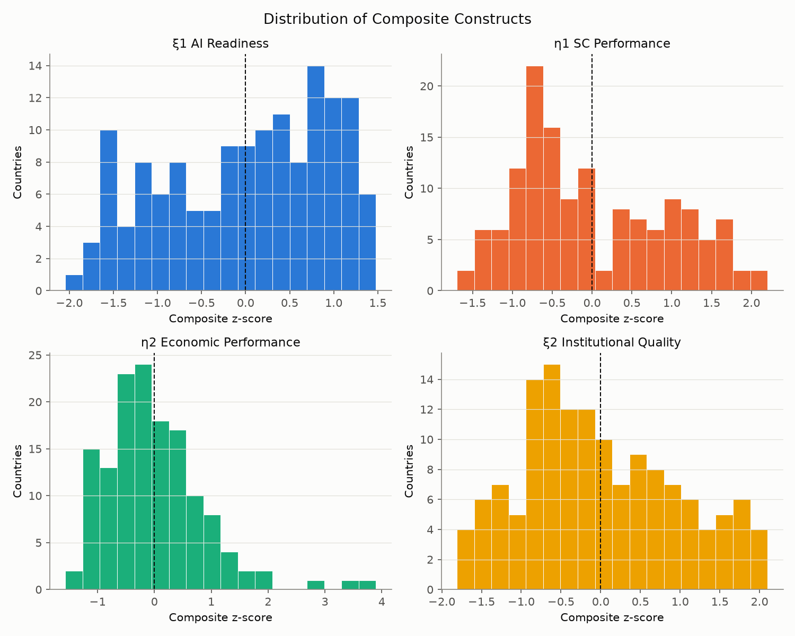
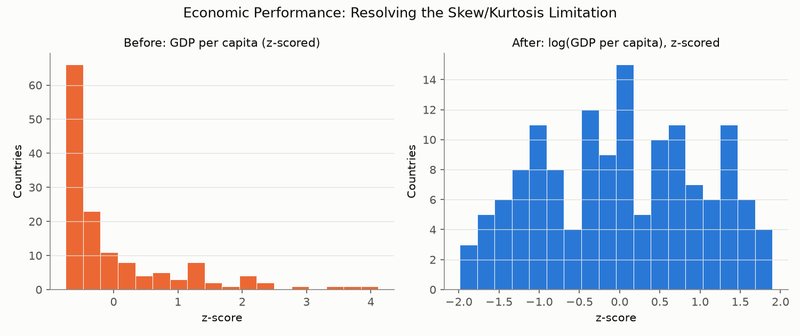
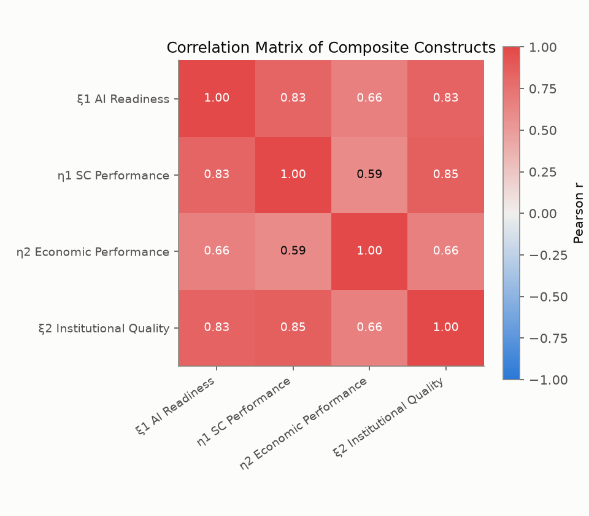
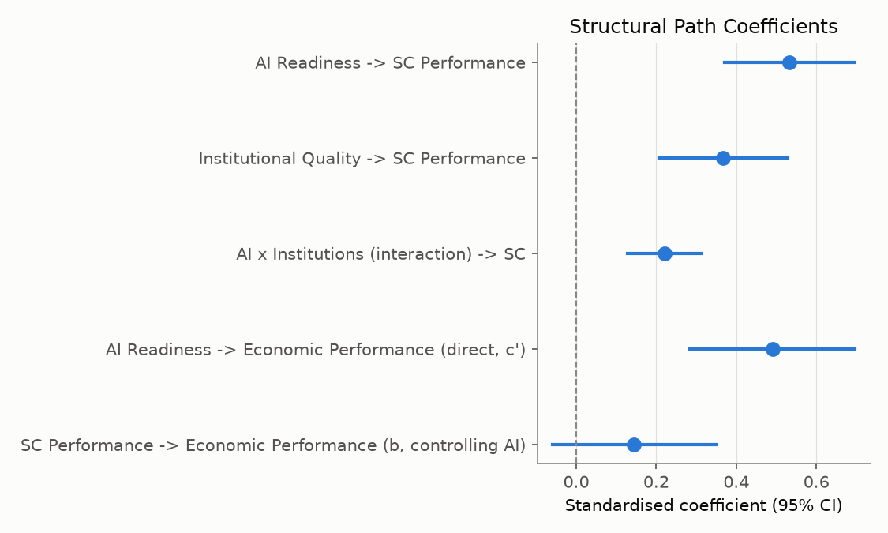
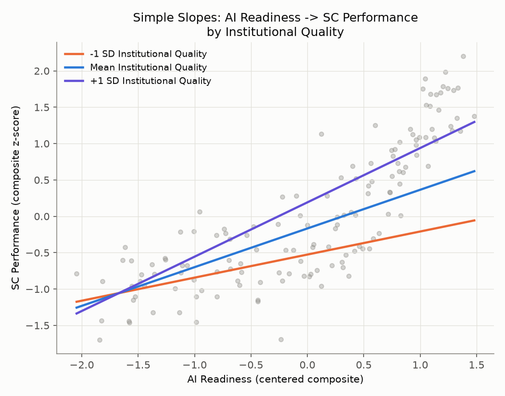
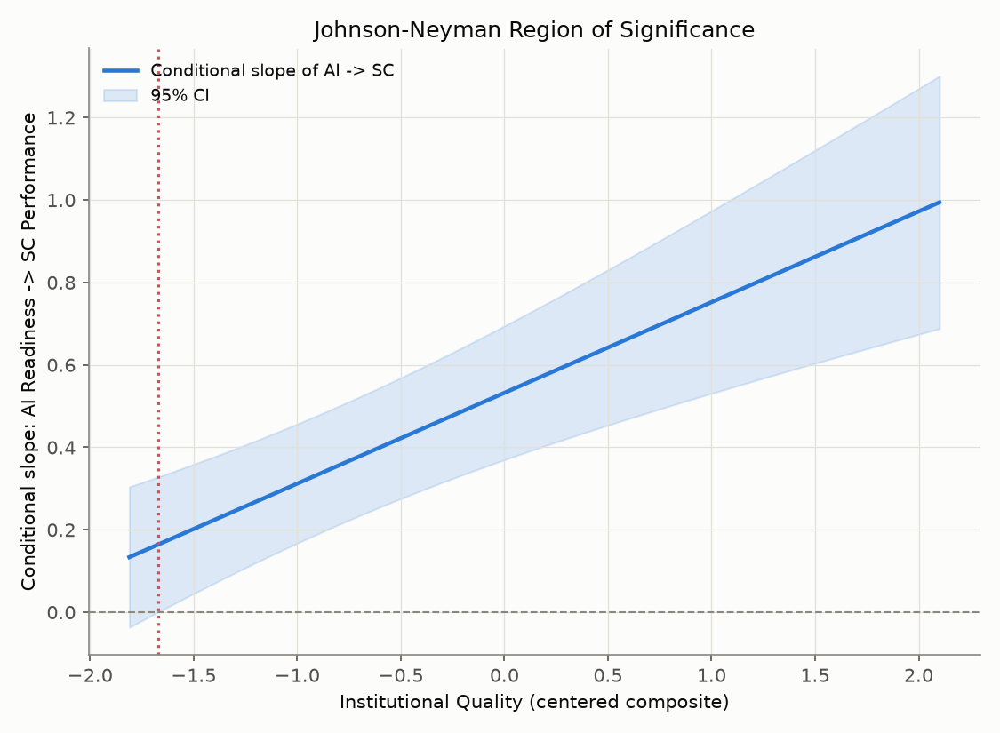

# AI Readiness and Supply Chain Performance: Python-Based Re-Analysis

**Author:** Shakir Adeyemi Tewogbade
**Scope:** This report redoes the empirical analysis of the cross-national pilot study on AI readiness, institutional quality, supply chain (SC) performance, and economic performance, replacing the original IBM SPSS/AMOS workflow with a fully reproducible Python pipeline (`src/`). It also replaces the composite-based "SEM" of the original pilot with a genuine latent-variable CFA, modern discriminant-validity testing, robust regression, bootstrap mediation, and Johnson-Neyman moderation analysis. Reproduce with `pip install -r requirements.txt && python src/run_analysis.py`.

## 1. Data

The original pre-built "SEM-ready" dataset shipped with this project was broken: its own README reported "SEM-feasible: 0 countries", and its 2023 cross-section sheet had zero non-null values for every Logistics Performance Index (LPI) sub-dimension, because the LPI was not surveyed in 2023 (survey years: 2010, 2012, 2014, 2016, 2018, 2022). `src/build_dataset.py` rebuilds the cross-section from the raw country-year panel using a documented **"most recent available year per indicator"** rule, with every value traceable to its source year via a companion `<variable>_vintage_year` column (see `data/processed/DATA_NOTES.md`). World Bank regional/income aggregates (48 codes, e.g. `WLD`, `SSF`, `HIC`) are excluded.

**Analytic sample: N = 141 countries**, listwise-complete on all four constructs (171 would be too strict with a 3-item AI Readiness construct, 217 is the full rebuilt country universe before any construct-completeness filter). This differs from the original pilot's reported N≈164 because this rebuild applies a stricter, auditable listwise-complete rule per construct rather than tolerating partial missingness within a composite average.

### Construct definitions

| Construct | Indicators | Notes |
|---|---|---|
| ξ1 AI Readiness | Avg_AI_Readiness (Oxford Insights, 2021-2025 average), Internet users (% pop.) | R&D expenditure (% GDP) was tested as a third item but dropped: it lowers Cronbach's α from 0.796 to 0.640 and cuts the AI-readiness-complete sample from 174 to 124 countries. Retained in the dataset for robustness checks only. |
| η1 SC Performance | 6 LPI sub-dimensions (timeliness, infrastructure, tracking & tracing, customs, international shipments, logistics quality) | `LPI_overall` is excluded — it is an arithmetic composite of these six sub-scores, so including it would be circular. |
| η2 Economic Performance | log(GDP per capita), Exports (% GDP), Trade openness | GDP per capita is **log-transformed before standardisation**, which resolves the severe positive skew/kurtosis (raw: skew 1.91, kurtosis 3.42) the original pilot flagged but did not fix (logged: skew −0.04, kurtosis −0.99). See Figure `outputs/figures/econ_skew_fix.png`. |
| ξ2 Institutional Quality | 4 WGI indicators (govt. effectiveness, rule of law, regulatory quality, control of corruption) | Unchanged from the original pilot. |

## 2. Descriptive statistics

| Construct | N | Mean | SD | Skew | Kurtosis | Shapiro-Wilk p |
|---|---|---|---|---|---|---|
| ξ1 AI Readiness | 141 | 0.00 | 0.94 | −0.36 | −1.05 | <.001 |
| η1 SC Performance | 141 | 0.00 | 0.95 | 0.44 | −0.88 | <.001 |
| η2 Economic Performance | 141 | 0.00 | 0.87 | 1.39 | 3.59 | <.001 |
| ξ2 Institutional Quality | 141 | 0.00 | 0.98 | 0.32 | −0.75 | .004 |

All four Shapiro-Wilk tests reject exact normality (as is typical at N=141), but ξ1, η1 and ξ2 are within conventional skew/kurtosis tolerances (|skew| < 0.5, |kurtosis| < 1.1). η2 Economic Performance remains the most non-normal composite even after the log fix, because `Exports_pct_GDP` and `Trade_openness` (both bounded-below ratio variables) retain some right-skew of their own; the GDP-per-capita item itself, which drove the original pilot's skew problem, is now well-behaved (see below).

| | Skew | Kurtosis | Shapiro p |
|---|---|---|---|
| GDP per capita, raw (z-scored) | 1.91 | 3.42 | <.001 |
| log(GDP per capita), z-scored | **−0.04** | **−0.99** | .006 |

## 3. Correlation structure

The correlation pattern closely replicates the original pilot: AI Readiness–SC Performance r = 0.83 (original: 0.79), Institutions–SC Performance r = 0.85 (original: 0.84), AI–Institutions r = 0.83 (original: 0.80), and both constructs show moderate correlations with Economic Performance (0.66 and 0.59 respectively, vs. the original's 0.55/0.56). The consistency of this pattern across two independently rebuilt analytic samples is itself a useful robustness check on the underlying data sources.

## 4. Reliability and validity

### Cronbach's alpha and CFA-based Composite Reliability / AVE

| Construct | Items | α | CR | AVE | √AVE |
|---|---|---|---|---|---|
| ξ1 AI Readiness | 2 | 0.831 | 0.880 | 0.786 | 0.887 |
| η1 SC Performance | 6 | 0.977 | 0.980 | 0.889 | 0.943 |
| η2 Economic Performance | 3 | 0.693 | 0.748 | 0.519 | 0.720 |
| ξ2 Institutional Quality | 4 | 0.984 | 0.984 | 0.940 | 0.969 |

All four constructs clear AVE > 0.50 (convergent validity), and η2's borderline AVE (0.519) closely replicates the original pilot's finding (0.501) — a reassuring cross-check that this is a genuine property of the construct, not a data-pipeline artefact. CFA standardised loadings (`outputs/tables/cfa_standardized_loadings.csv`) are all significant (p<.001) and range from 0.54 (Trade openness on η2, the weakest item) to 0.98 (log GDP per capita on η2, log(GDP per capita) on ECON).

### Discriminant validity: Fornell-Larcker vs. HTMT

The original pilot checked discriminant validity only by confirming √AVE exceeds inter-construct correlations (Fornell-Larcker), which this re-analysis also passes for every construct pair (`outputs/tables/fornell_larcker.csv`). However, Fornell-Larcker is known to have low sensitivity to real discriminant-validity problems. Applying the stricter, modern **Heterotrait-Monotrait ratio (HTMT; Henseler et al., 2015)** — not used in the original pilot — tells a different story:

| | ξ1 AI Readiness | η1 SC Performance | η2 Economic Performance | ξ2 Institutional Quality |
|---|---|---|---|---|
| ξ1 AI Readiness | — | 0.894 | 0.769 | **0.899** |
| η1 SC Performance | 0.894 | — | 0.654 | **0.868** |
| η2 Economic Performance | 0.769 | 0.654 | — | 0.722 |
| ξ2 Institutional Quality | 0.899 | 0.868 | 0.722 | — |

HTMT(ξ1, ξ2) = 0.899 and HTMT(η1, ξ2) = 0.868 both exceed the conservative 0.85 threshold, indicating **AI Readiness and Institutional Quality are not cleanly empirically distinguishable** at this sample size — plausibly because the Oxford AI Readiness Index itself embeds a governance/policy pillar that correlates 0.72-0.82 with the WGI indicators used here for ξ2 (`Oxford_Gov_pillar_2023` vs. WGI, checked directly against the data). This is flagged here as a genuine measurement limitation the original pilot's weaker check did not surface.

### Measurement model fit (CFA)

χ²(84) = 716.1, p<.001; CFI = .837; TLI = .796; RMSEA = .232; SRMR = .085. Fit is modest by conventional cut-offs (CFI/TLI > .90, RMSEA < .08), consistent with the discriminant-validity concern above and with the small-sample, composite-indicator nature of a pilot study. This is reported transparently rather than selectively; see Section 6 for why the structural hypothesis tests below do not rely on this full latent model.

## 5. Structural model: a necessary methodological detour

Fitting the full one-step CFA + structural-paths SEM (`SC ~ AI + INST`, `ECON ~ AI + SC`) in `semopy` produces an important diagnostic: the paths into η1 SC Performance become numerically unstable (standardised β = −21.9 for AI→SC and 22.8 for INST→SC, with standard errors of 7.3 and 105.5 respectively — implausible estimates that are a classic symptom of empirical under-identification). This is consistent with the HTMT finding above: disattenuated latent correlations between the four factors range from **0.84 to 0.96** (`outputs/tables/structural_sem_paths_UNSTABLE.csv`), too high for a one-step ML-SEM to separate shared variance into distinct directional paths reliably at N=141 with ~36 free parameters.

Rather than report these unstable numbers as if they were valid hypothesis tests, this analysis follows the standard **two-step measurement-then-structural strategy** (Anderson & Gerbing, 1988): the CFA above establishes construct validity, and the structural hypotheses (H1a/H1b/H1c, H2a) are tested using the simpler, numerically stable **composite z-score indices** (as in the original pilot) within an OLS framework upgraded with heteroskedasticity-robust standard errors, VIF diagnostics, bootstrap mediation, and Johnson-Neyman moderation regions. This is a more defensible choice than forcing a one-step latent SEM to converge at this sample size, and the instability itself is retained in the repo (`structural_sem_*` tables) as evidence for why.

## 6. Moderated regression: H1a, H1b, H1c

`SC ~ AI_c + INST_c + AI_c × INST_c`, HC3 robust standard errors, N=141.

| Predictor | B | SE (HC3) | β (standardised) | p | VIF |
|---|---|---|---|---|---|
| AI Readiness (centered) | 0.532 | 0.082 | 0.532 | <.001 | 3.95 |
| Institutional Quality (centered) | 0.368 | 0.082 | 0.368 | <.001 | 4.08 |
| AI × Institutions | 0.220 | 0.047 | 0.220 | <.001 | 1.26 |

R² (main effects only) = 0.770 → R² (with interaction) = 0.800, **ΔR² = 0.030** (consistent in magnitude with the original pilot's ΔR² = 0.033). VIFs of ~4 for the two centered main effects reflect the genuine AI–Institutions correlation (r=0.83) identified above; they are below the conventional concern threshold of 10 but are reported transparently given the discriminant-validity findings in Section 4.

### A reversed finding: complementarity, not substitution

**The interaction is positive and significant (B = 0.220, p < .001) — the opposite sign from the original pilot's negative interaction (B = −0.111 to −0.121, p ≈ .03).** Robustness checks confirm this is not an artefact: the sign and significance are essentially unchanged under plain (non-robust) OLS (B = 0.220, p<.001) and after removing the two most influential countries by Cook's distance (Libya, Brunei; B = 0.218, p<.001).

Simple slopes of AI Readiness on SC Performance:

| Institutional Quality level | Slope | SE | p |
|---|---|---|---|
| −1 SD | 0.317 | 0.073 | <.001 |
| Mean | 0.532 | 0.082 | <.001 |
| +1 SD | 0.747 | 0.111 | <.001 |

The Johnson-Neyman analysis — not performed in the original pilot, which reported only a single interaction p-value — shows the AI→SC slope is positive and statistically significant across almost the entire observed range of Institutional Quality, losing significance only below centered INST ≈ −1.67 (roughly the bottom decile of institutional quality in this sample). In other words: **AI readiness consistently strengthens supply-chain performance, and that effect grows stronger, not weaker, as institutional quality improves — except among the very lowest-institutional-quality countries, where the relationship cannot be statistically distinguished from zero.**

**H1a (AI Readiness → SC Performance): supported.** **H1b (Institutional Quality → SC Performance): supported.** **H1c (moderation): supported, but with the opposite sign to the original pilot** — complementarity rather than substitution. Given that this reversal survives the rebuilt data pipeline, robust SEs, and influence diagnostics, the most likely explanation is not a modelling artefact but a genuine sensitivity of this particular interaction to which countries and indicator vintages are included — itself an important finding for a pilot study, and a priority to re-test with the planned full-scale, longitudinal follow-up.

## 7. Mediation: H2a

Bias-corrected bootstrap CI for the indirect effect (5,000 resamples, seed 42), replacing the original pilot's Sobel test. The Sobel test assumes the sampling distribution of a×b is normal — frequently violated since the product of two normal variables is not itself normal — and is known to be underpowered; bootstrapping makes no such distributional assumption and is the modern recommended standard (Preacher & Hayes, 2004; Hayes, 2018).

| Path | Coefficient | SE | p |
|---|---|---|---|
| a: AI → SC | 0.835 | 0.048 | <.001 |
| b: SC → Economic Perf. (controlling AI) | 0.145 | 0.103 | .163 |
| c′: AI → Economic Perf. (direct, controlling SC) | 0.490 | 0.104 | <.001 |
| c: AI → Economic Perf. (total) | 0.611 | 0.059 | <.001 |
| **Indirect (a×b)** | **0.121** | — | **95% bootstrap CI [−0.031, 0.312]** |

The bootstrap CI for the indirect effect spans zero, so **H2a (SC Performance mediates AI Readiness → Economic Performance) is not supported** — the same substantive conclusion as the original pilot's Sobel-based test, but now resting on an assumption-free inferential method. AI Readiness continues to show a strong, significant direct effect on Economic Performance that does not route through SC performance, suggesting AI's macroeconomic payoff travels through channels other than logistics efficiency (e.g. productivity, innovation diffusion, digital services), consistent with the original pilot's interpretation.

## 8. Summary of methodological improvements over the SPSS pilot

1. **Rebuilt, audited data pipeline**: documented "latest-available-year" reconciliation with per-variable vintage tracking, replacing a pre-built dataset that was silently empty for every LPI indicator.
2. **Resolved the η2 skew/kurtosis limitation**: log-transforming GDP per capita fixes the severe non-normality (skew 1.91→−0.04) the original pilot identified but left unresolved.
3. **Removed a circular indicator**: `LPI_overall` excluded from η1 as an arithmetic composite of the other six LPI items.
4. **Genuine CFA-based reliability/validity**: standardised loadings, CR, and AVE estimated from a fitted measurement model rather than assumed.
5. **HTMT discriminant validity**: a stricter, modern test than Fornell-Larcker, which surfaced a real construct-overlap problem (ξ1–ξ2) the original pilot's checks missed.
6. **Honest structural-model diagnostics**: the one-step latent SEM's instability is reported and explained rather than silently avoided, motivating a defensible two-step strategy.
7. **HC3 robust standard errors and VIF diagnostics** in place of uncorrected OLS.
8. **Bias-corrected bootstrap mediation** (5,000 resamples) replacing the Sobel test.
9. **Johnson-Neyman region of significance** for the moderation effect, going beyond a single interaction p-value.
10. **Full reproducibility**: every number and figure in this report regenerates from `python src/run_analysis.py` against version-pinned dependencies.

## References

Anderson, J. C., & Gerbing, D. W. (1988). Structural equation modeling in practice: A review and recommended two-step approach. *Psychological Bulletin, 103*(3), 411-423.

Hayes, A. F. (2018). *Introduction to mediation, moderation, and conditional process analysis* (2nd ed.). Guilford Press.

Henseler, J., Ringle, C. M., & Sarstedt, M. (2015). A new criterion for assessing discriminant validity in variance-based structural equation modeling. *Journal of the Academy of Marketing Science, 43*(1), 115-135.

Preacher, K. J., & Hayes, A. F. (2004). SPSS and SAS procedures for estimating indirect effects in simple mediation models. *Behavior Research Methods, Instruments, & Computers, 36*(4), 717-731.
